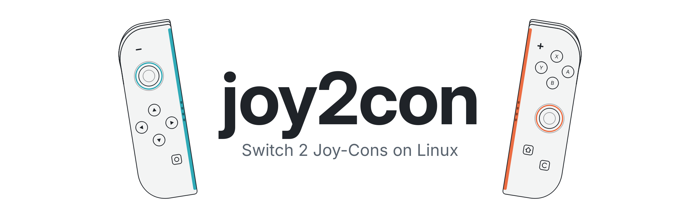
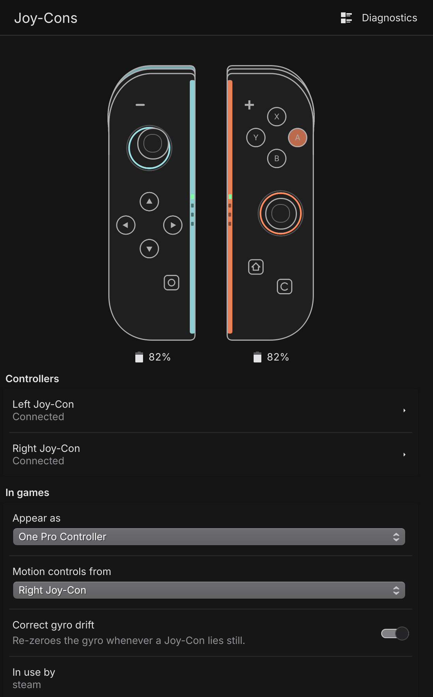
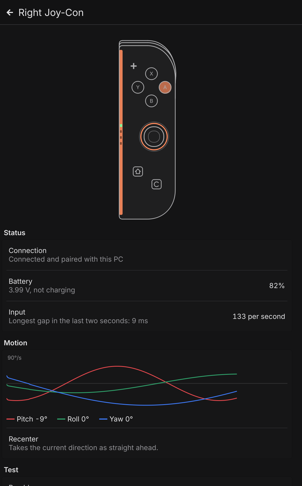

<p align="center">
  <picture>
    <source media="(prefers-color-scheme: dark)" srcset="docs/banner-dark.png">
    
  </picture>
</p>

<p align="center">
  <a href="https://github.com/jacc/joy2con/releases"></a>
  
  <a href="https://github.com/jacc/joy2con/actions/workflows/check.yml"></a>
  <a href="LICENSE"></a>
  
  
</p>

joy2con is a Linux driver for the Nintendo Switch 2 Joy-Cons. It pairs with
them over Bluetooth and presents them to the system as original Switch
controllers, which the kernel, Steam, SDL games and Wine already understand.
Motion controls, rumble, player lights and battery all work, and a KDE app
shows what each Joy-Con is doing.

> [!WARNING]
> joy2con is in beta and has been tested on one PC so far (details under
> [Compatibility](#compatibility)). If something doesn't work on yours, please
> [open an issue](https://github.com/jacc/joy2con/issues/new?template=bug_report.yml)
> with your Bluetooth adapter and distribution.

## Why it's needed

The Switch 2 Joy-Cons don't use Bluetooth Classic like the originals, and they
skip standard Bluetooth LE pairing. Your desktop's Bluetooth settings can see
them but never finish pairing, and no kernel driver exists for them yet.
joy2con speaks their protocol directly, so nothing else on your system has to
change to use them.

## Features

- Both Joy-Cons as one Pro Controller, or each as its own Joy-Con, switchable at any time
- Gyro and accelerometer at the controller's full rate, calibrated from each
  Joy-Con's factory data, with drift corrected whenever it lies still
- Rumble from games, converted for the Joy-Con 2's motors
- Player lights set by the game, and battery level reported to the system
- Pairing from the PC, after which a button press wakes the Joy-Con and it reconnects
- A KDE app and tray icon: live buttons, sticks and motion, battery, link
  quality, and which programs are using the controller

<p align="center">
  
  &nbsp;
  
</p>

## Compatibility

| Controller | Status |
|---|---|
| Joy-Con 2 (L) and (R) | Supported |
| Switch 2 Pro Controller | Not yet |
| Nintendo Switch Online GameCube controller | Not yet |

| Used through | Status |
|---|---|
| Kernel `hid-nintendo` driver (evdev, `/dev/input`) | Tested |
| SDL games | Tested |
| Steam and Steam Input | Should work (Steam supports the original controllers); not tested yet |
| Wine and Proton | Should work through SDL; not tested yet |

Tested on CachyOS with Linux 7.3, BlueZ 5.87, KDE Plasma 6, Python 3.14 and
PySide6 6.12, a UGREEN BT 6.0 USB adapter, and Joy-Cons on firmware 2.1.4.

## Install

### Arch Linux and derivatives

An AUR package is on the way. Until then, build the same package from this
repository:

```sh
git clone https://github.com/jacc/joy2con.git
cd joy2con/packaging/arch
makepkg -si
```

### Other distributions

You need Python 3.11 or newer and BlueZ 5.66 or newer. For the app, also
install your distribution's PySide6 (Qt 6), Kirigami, Kirigami Addons and
qqc2-desktop-style packages; the driver runs without them.

```sh
git clone https://github.com/jacc/joy2con.git
cd joy2con
./install.sh        # into your home folder, no root; ./install.sh --uninstall removes it
```

The script tells you if it needs anything it can't do itself, such as
permission to create controllers through `/dev/uhid`. Steam's device rules,
installed with Steam on most distributions, already grant that.

## Setup

```sh
joy2con setup                          # one-time Bluetooth settings; asks for your password
systemctl --user enable --now joy2con  # start the driver now and at every login
joy2con                                # open the app
```

Then press the small sync button on a Joy-Con's rail. joy2con pairs it,
flashes the player lights and plays a click. From then on, pressing any
button wakes it and it reconnects by itself.

`joy2con setup` edits `/etc/bluetooth/main.conf` (keeping the original as
`main.conf.joy2con.bak`) and restarts Bluetooth, which briefly disconnects
your other Bluetooth devices. It sets:

- the connection interval to 7.5 ms, the shortest Bluetooth allows. The
  Joy-Con 2 uses whatever interval the PC offers, and BlueZ's default of
  30 to 50 ms would limit it to about 20 updates a second.
- BlueZ's experimental features, which provide the low-power scan joy2con
  uses to notice a Joy-Con waking up.

To keep the tray icon at login, copy `joy2con-tray.desktop` (in
`/usr/share/joy2con/` for the Arch package, `data/` in the source) to
`~/.config/autostart/`.

## Usage

| Command | What it does |
|---|---|
| `joy2con` | Opens the app. Closing the window leaves the driver running. |
| `joy2con status` | Prints the connected Joy-Cons, their report rates and battery, and which programs use them. |
| `joy2con daemon [-v]` | Runs the driver in the foreground, normally done by the systemd service. |
| `joy2con setup` | Applies the Bluetooth settings above. |

In the app, "Appear as" switches between one Pro Controller and two separate
Joy-Cons. In Pro Controller mode, "Motion controls from" picks which Joy-Con
supplies the gyro.

## Troubleshooting

**A Joy-Con won't connect, or input stutters.** Close your desktop's
Bluetooth "Add device" window if it's open. While it searches for devices the
radio has little time left, so Joy-Cons fail to connect and connected ones
lose input. The app shows a warning while this is happening.

**With both Joy-Cons connected, each reports about 65 times a second instead of 133.**
Some Bluetooth adapters serve only one connection per 7.5 ms, so two Joy-Cons
take turns. On the tested UGREEN adapter one Joy-Con alone reaches 126 reports
a second and two reach about 64 each; changing the radio mode and packet sizes
made no difference. The app says so on each Joy-Con's page when it happens.
That's still the rate original Joy-Cons use, but if you know an adapter that
does better, please share it in an issue.

**A Joy-Con is "paired with a Switch".** joy2con leaves Joy-Cons paired to a
console alone until you choose "Use with this PC" in the app. Pairing with the
PC may replace the console pairing; attaching the Joy-Con to the console pairs
it there again.

**Where are the logs?** `journalctl --user -u joy2con`, and the Diagnostics
page in the app.

## How it works

```
Joy-Con 2 ──BLE──► joy2con daemon ──/dev/uhid──► "Nintendo Switch Pro Controller"
                    (GATT over a raw          ──► hid-nintendo, Steam, SDL, Wine
                     L2CAP socket)
                         │ Unix socket, readable only by you
                         ▼
                    joy2con app and tray
```

The daemon talks to each Joy-Con's GATT service over a raw L2CAP socket, which
keeps BlueZ's pairing attempts out of the way. It decodes the input reports
and creates a virtual original Switch controller through `/dev/uhid`, answering
the host exactly as the real one would: subcommands, SPI flash reads for
calibration, full report mode with three motion samples per report, and
rumble. The daemon runs as your user and needs no root; the app is only a
client of it.

## Development

```sh
python3 -m joy2con daemon -v               # the driver in the foreground, with debug logging
python3 tools/demo_daemon.py /tmp/demo.sock &
JOY2CON_SOCKET=/tmp/demo.sock python3 -m joy2con   # the app against sample data, no Joy-Cons needed
python3 tools/docs_images.py               # regenerate the images in docs/
```

## Not done yet

- Switch 2 Pro Controller and GameCube controller support
- Mouse mode using the Joy-Con 2's optical sensor
- One Joy-Con per Bluetooth adapter, for full rate on adapters that share
- A Flatpak, for Steam Deck and other systems with a read-only root

## Credits

The Joy-Con 2 protocol comes from the community documentation in
[ndeadly/switch2_controller_research](https://github.com/ndeadly/switch2_controller_research).
SDL's HIDAPI drivers and the kernel's `hid-nintendo` driver were read to see
how hosts drive the original Switch controllers. joy2con contains no code
from these projects.

## License

joy2con is free software under the [GNU General Public License v3.0 or later](LICENSE).

Nintendo Switch and Joy-Con are trademarks of Nintendo. joy2con is not
affiliated with or endorsed by Nintendo. The controller drawings are original
artwork.
